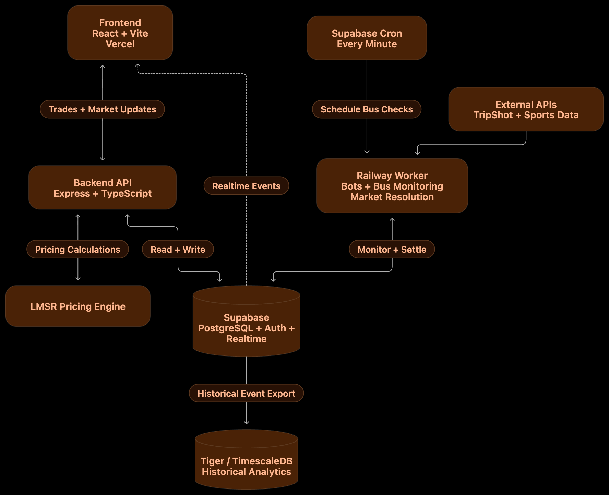

# Scarlet Exchange

Scarlet Exchange is a Rutgers-campus prediction-market platform built for HackRU 2026. Participants use play money ($R) to buy YES or NO shares on questions about Rutgers buses, football, basketball, and presentation demos.

Each share has a continuously changing price produced by an LMSR (logarithmic market scoring rule) pricing engine. A YES or NO share pays $R1 when the market resolves on that side. If the evidence is missing, stale, or contradictory under the market’s committed rules, the market can resolve VOID and refund the original purchase cost.

The application is designed to demonstrate a complete market lifecycle:

1. A user signs in and selects a market.
2. The API validates the request, calculates an LMSR quote, and commits the trade, wallet transfer, position, price event, and audit/outbox records in one PostgreSQL transaction.
3. The frontend receives market updates through the API and Supabase Realtime, then refreshes charts, balances, and holdings.
4. Automation workers read authorized external data, evaluate each market’s frozen resolution rule, and settle YES, NO, or VOID.
5. Settlement creates an immutable receipt and pays winning shares or refunds VOID positions.

The platform uses play money only and is not affiliated with Rutgers University.

## Architecture



### Frontend and API

The React + Vite frontend is served through Vercel. It displays markets, quotes, charts, trades, holdings, receipts, automation state, and the one-minute presentation demo. The TypeScript Express API handles authenticated requests, market reads, quote generation, trades, settlement receipts, and administrative controls. Vercel routes `/api` requests to the API bundle.

The browser only receives public configuration and authenticated API responses. Database URLs, provider credentials, runtime roles, and service keys remain server-side.

### Supabase PostgreSQL, Auth, and Realtime

Supabase PostgreSQL is the authoritative transactional store. Prisma models environments, markets, wallets, positions, trades, transfers, events, evidence, settlements, payouts, automation jobs, and presentation runs.

Supabase Auth verifies hosted users. Row-level security protects private application tables, while the API performs ownership and admin authorization checks. Public market events can be streamed through Supabase Realtime so multiple clients can recover chart and quote updates.

When enabled, Supabase `pg_cron` runs a minute-level coordinator. It only enqueues a leased College Avenue bus-check job; it does not poll TripShot or replace the worker.

### Railway worker and external providers

The Railway worker is the continuous automation process. It claims database-backed jobs, polls authorized providers, evaluates frozen market rules, and settles markets. It is the only service that should run the long-lived automation loop in production.

TripShot supplies Rutgers bus predictions and vehicle positions. Sports adapters use Rutgers-relevant data from football and basketball providers. The worker rejects stale, missing, wrong-route, wrong-trip, or otherwise unverified evidence according to the market’s committed rule. A data outage is not treated as a losing result.

### LMSR pricing and ledger

The LMSR engine updates the YES/NO price as shares are bought or sold. Quotes include the order cost, price per share, maximum payout, gross payout multiple, net profit, and net return on investment. The accounting layer uses integer micro-$R amounts, idempotency keys, explicit PostgreSQL locks, and reconciliation checks for balances, shares, payouts, and total supply.

### Historical analytics in Tiger / TimescaleDB

Committed market events are exported through a leased outbox pipeline to Tiger / TimescaleDB. Tiger stores rebuildable historical data and time-series aggregates such as minute-level price, trade-count, and volume history. The API combines Tiger history with the authoritative PostgreSQL tail and labels a bounded PostgreSQL fallback when Tiger is unavailable.

## Presentation demo

The presentation demo is a real market using the same LMSR engine, wallet ledger, positions, event stream, chart, and settlement code as participant trades. Synthetic bots trade through the normal buy/sell path, and the timer is server-authoritative.

The demo resolves YES when the 60-second deadline passes without an early finish action, or NO when an authorized finish action occurs before the deadline. Once complete, the market remains on its detail page so the outcome and settlement receipt can be reviewed. An admin can archive it manually when finished.

## Local development

Requirements: Node 22+, npm, and PostgreSQL 15+.

```sh
npm install
cd vite-project
npm ci
cp .env.example .env
npm run db:generate
npm run db:migrate
npm run demo:new
```

For a complete local demo, from the repository root run:

```sh
npm run demo
```

The demo starts the API, Vite frontend, and worker together. Open <http://localhost:5173>. For manual process control, run `npm run api`, `npm run dev`, and `npm run worker` from `vite-project` in separate terminals.

The local demo uses a separate DEMO environment and local development authentication. Do not point a local worker at a production database unless you intentionally want it to mutate production automation state.

## Useful commands

```sh
npm run build       # Type-check and build the frontend
npm test            # Run application and automation tests
npm run test:db     # Run database-backed tests
npm run worker      # Run the persistent automation worker
npm run demo:export -- <environment-uuid>
npm run demo:replay -- <environment-uuid>
```

For hosted Supabase, Tiger, TripShot, deployment, and verification instructions, see:

- [Detailed application setup](vite-project/README.md)
- [Architecture deep dive](vite-project/docs/ARCHITECTURE.md)
- [Automation policies and operations](vite-project/docs/AUTOMATION.md)
- [API reference](vite-project/docs/API.md)
- [Verification status](vite-project/docs/VERIFICATION.md)
- [GitHub Pages guide](docs/DEPLOY_GITHUB_PAGES.md)

## Repository layout

```text
vite-project/       React frontend, Express API, worker, Prisma schema, tests
supabase/           Hosted database migrations and coordinator functions
docs/               Deployment documentation and architecture diagram
backend/            Supporting data-collection components
```

## License and project status

This is a HackRU student project using play money. It is not a financial product, does not process real-money purchases, and does not claim official Rutgers affiliation.
