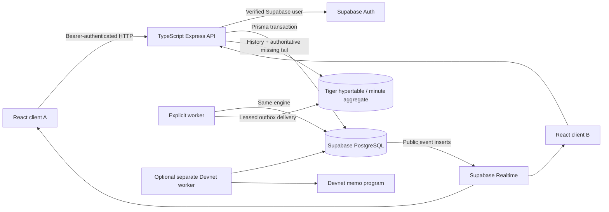

# Scarlet Exchange architecture

## Accounting and concurrency

All amounts are BIGINT micro-R serialized as decimal strings. Decimal.js uses 60-digit precision and stable log-sum-exp; positive order costs round upward to a micro-R, including underflow-sized positive orders. Liquidity is fixed at opening. A $R 100 maker reserve exceeds the b=100 subsidy bound. The supported single order is 1–1,000 integer shares; outstanding market totals are bounded.

An environment starts with $R 1,000,000 in the treasury's immutable opening balance. Every other wallet starts at zero. Grants, maker funding, purchases and payouts create two-sided transfer rows. Reconciliation checks individual balances, total supply, aggregate shares, and payout/transfer totals.

Lock order is environment (only when initializing/granting or coordinating DEMO clock), then market, then wallets sorted by UUID. LIVE trades serialize by market and shared wallet; DEMO additionally serializes environment actions to obtain deterministic virtual-time ordering. PostgreSQL READ COMMITTED with explicit row locks is intentional. The clock is checked after lock acquisition. Money transactions never call external providers, Tiger, or Solana. Bounded retries handle deadlocks and uniqueness races.

Trades look up wallet-scoped idempotency before status checks and recheck after locks. The normalized economic request includes environment, market, side, quantity and maximum cost. Exact retries return the original execution after close; conflicting reuse fails. A transfer, position, executed trade, market version, event and outbox job commit together.

Settlement locks the market and wallets, validates the frozen evidence contract and finality, pays integer winning shares or refunds original cost for VOID, records even zero losing payouts, and appends an event/outbox entry. A second conflicting outcome/evidence hash fails.

## Identity and access

Hosted requests verify bearer tokens with Supabase `auth.getUser`. The server derives the profile and wallet from the verified subject. Admin authorization uses server-controlled `app_metadata.role`; user-editable metadata is never trusted. Profile names/campus may be edited, permissions may not.

Application tables have RLS. Only append-only public market events are granted browser SELECT. Private data, including evidence payloads, comes through ownership/admin-checked APIs. `prisma/runtime-role.sql` provides an explicit server role policy/grant set without Supabase system-schema ownership. The API role remains a trusted backend, not a browser identity. No service key is needed in frontend code.

Local demo identity is a separate, ephemeral signed bearer token. It is enabled only by `LOCAL_DEMO_AUTH=true` outside production, binds the API to 127.0.0.1, and is denied access to LIVE account mutations. It exists for offline demonstration, not as a substitute for hosted Supabase Auth. Restarting the API invalidates local tokens. Per-process rate limits and Origin checks protect mutations; production scaling needs a shared rate-limit store/reverse proxy. No cookie-authenticated mutation endpoints are used.

## History and recovery

Each public event has a contiguous market version. A chart subscribes first, buffers events, loads history with a snapshot version, discards covered versions and applies contiguous events. Gaps/reconnects trigger bounded event recovery. The headline quote is refreshed from PostgreSQL after the history snapshot as well as each applied event. Two-second polling backs off to 15 seconds on errors and survives unavailable Realtime. Chart points collapse equal seconds deterministically and sum all underlying traded volume. Settlement is a marker, never an invented trade.

Tiger is a rebuildable copy. The exporter takes a single-worker advisory lock, claims expiring leases, preserves event ID/time on retries, writes with `ON CONFLICT(event_time,event_id) DO NOTHING`, then acknowledges. Earlier undelivered events block later events for the same market. A watermark is the first missing version minus one, not a maximum delivered version. History reads Tiger through that watermark and appends the committed PostgreSQL tail. It labels a bounded ledger-only fallback explicitly. A 10,000-event cap is disclosed through `truncated`; range controls request up to 31 days. Large-scale historical pagination/rollups are future work.

The minute aggregate counts only PRICE_CHANGED events, sums micro-R volume, and orders first/last by unique per-market version, including same-time events. `materialized_only=false` includes recent unmaterialized rows. Refresh policy is explicit. No audit retention is applied to the ledger.

## Resolution providers and demo

CFBD and CBBD adapters verify game ID, Rutgers participation, cutoff before game start and completed/final status. API errors, missing scores and missing credentials return pending. Because the providers do not expose a verified end timestamp in the used schema, `observedAt` means the adapter's final-status observation time; frozen sports windows must include that observation. CBBD's 2027 season represents the 2026–27 season. Weather/bus observations use a fixed server-configured normalized adapter. Concert/election absence requires channels checked, never a failed fetch.

A run seeds six explicitly synthetic templates and 20 named bots. Bots use the exact buy engine and environment-scoped runner identity. The worker advances virtual time, creates purchases, closes at 120 scenario seconds and injects final fixture evidence at 150 seconds. Pause stops virtual-clock advancement. New run inserts new rows; it does not reset shared data. Deterministic replay consumes the ordered accepted action log, seed, initial clock and fixture version, remapping market/actor IDs. Human accepted purchases are included. Rejected inputs are not recorded and do not affect the replayed economic state. Concurrent load testing is separate.

## Optional commitments

A separate optional worker queues rule hashes while DRAFT and settlement receipt hashes after payout. It uses Solana Kit 8, v1 transactions and the memo program with the server-held development signer. RPC genesis identity must match official Devnet. Preflight/resource simulation stays enabled. Verification recomputes canonical SHA-256, checks confirmed successful transaction, expected signer, memo program and payload, and links to Devnet Explorer. Precommit status requires a confirmed block time strictly before `opensAt`. It proves publication/integrity, not correctness of the outcome. Chain downtime cannot roll back or block accounting; the worker is independent. A crash after submission but before signature persistence may repeat an identical public memo; it never repeats a payout.
