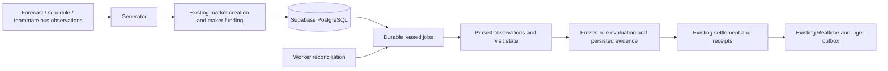

# Automated markets

The existing `createMarket → transfer → lifecycle → market_events/outbox` path creates and funds markets. Monitors call the existing `settle`, which owns refunds, payouts, receipts, portfolio balances and leaderboard accounting. There is no second ledger or trading engine.



## Startup and deployment

From `vite-project`, Node 22+ and PostgreSQL 15+:

```sh
npm ci
npm run db:generate
npm run db:migrate
npm run api
# Separate supervised process, with the same server environment:
npm run worker
```

Use the existing `DATABASE_URL` runtime connection and `DIRECT_DATABASE_URL` migration-owner connection. Keep TLS verification enabled. Apply `prisma/runtime-role.sql` when provisioning the runtime role; the automation migration grants an already-provisioned role access to the new tables. Browser roles receive no operational-table access. If the teammate bus migrations are applied later, rerun the bus grant/policy block at the end of `runtime-role.sql`.

The queue extends the existing PostgreSQL lease/outbox approach. It has a unique environment/job key, `FOR UPDATE SKIP LOCKED`, globally limited two concurrent claims, 120-second leases renewed every 30 seconds, and eight attempts with exponential backoff (30 seconds through one hour). Exhausted jobs remain FAILED for inspection/retry. Provider 429/503 cooldowns honor Retry-After up to one day. HTTP requests time out after ten seconds. No Redis, browser scheduler, session advisory lock, LISTEN connection, or serverless background task is required. Transaction-scoped advisory locking serializes claim-capacity checks and works with transaction pooling. Prisma owns the new tables, so there is no external queue-owned schema.

Run workers under a service supervisor; SIGINT/SIGTERM completes the current batch. Reconciliation runs every worker cycle and restores missing monitoring jobs, recovers funded drafts before cutoff, and voids unopenable drafts after cutoff. A crash between creation and enqueue does not strand a market. The unique `(environmentId,generatorKey)` and existing transaction/transfer constraints prevent duplicate funding. Proposed settlement evidence is persisted before invoking settlement so retries reuse identical receipt content.

## Configuration and operations

Generators are disabled until explicitly configured. Admin → Market automation offers validated settings, enable/disable, recent runs, provider-cache freshness, heartbeat, unresolved count, pending/failed jobs, and sync/retry. Changes affect future market rules. Disabling generation does not stop existing monitoring.

```sh
npm run automation -- enable <environment-uuid> temperature
npm run automation -- enable <environment-uuid> football
npm run automation -- enable <environment-uuid> basketball
npm run automation -- sync <environment-uuid>
npm run automation -- status <environment-uuid>
```

The CLI reads optional `AUTOMATION_SETTINGS` JSON. Admin settings use the same schema in `server/automation/core.ts`. Credentials are server-only: `NWS_USER_AGENT` (application plus monitored contact), `CFBD_API_KEY`, and `CBBD_API_KEY`. Neither MCP credentials nor fixture data are substituted for these settings. No sports credentials were available for authenticated provider verification.

| Generator | Defaults and frozen resolution |
| --- | --- |
| Temperature | Reconcile every 15 minutes; create tomorrow after local noon. KSMQ, Somerville/Somerset Airport (40.62, -74.67), not a campus measurement. Close at target local midnight. |
| Football | Discover every six hours, next five eligible games within 30 days. CFBD season uses calendar year. |
| Basketball | Same discovery policy, CBBD men's NCAA basketball only; ending-year seasons, e.g. 2027 for 2026–27. No women's coverage is asserted. |
| Bus | Read existing ingestion rows every five seconds. Requires verified stop coordinates and source timestamps; there is no second external poller. |

Weather uses complete hourly Open-Meteo forecasts in Fahrenheit at the configured station coordinates to choose a threshold: `floor(meanF / 5 + 0.5) * 5` (halfway toward positive infinity). The saved forecast snapshot and calculation never move prices or resolve the market. Generation first requires recent station coverage. Missing forecasts/credentials/funds become visible failed/skipped runs.

Settlement collects NWS observations every 30 minutes during the target day and backfills every 15 minutes afterward. Only finite Celsius values with NWS quality flag `V`, in [-90,60] °C, qualify. Deduplicate source IDs; average readings within each absolute one-hour interval, then equally average those hourly means. Luxon computes local midnight boundaries in America/New_York; DST days contain 23 or 25 buckets. Every bucket is required. Compare the unrounded mean strictly greater than threshold; equality is NO. Default reporting grace is two hours; after 36 hours beyond day end, missing coverage is VOID. Receipt raw evidence includes hourly means/counts and source/fetch timestamps. No forecast or reanalysis substitutes for observations.

Sports stores provider/team/game IDs, opponent, orientation, season, original start and response provenance. Provider-specific TBD fields are respected. Cutoff is five minutes before the original start and is enforced by the existing quote/buy service. A changed schedule or reported start closes trading and never reopens it. Poll hourly when more than six hours away, every five minutes until 30 minutes before start, then every minute. Shared database response caches prevent viewer-driven requests. CFBD's current scoreboard supplements its season endpoint for in-progress status. Two identical explicit final score/status results at least 60 seconds apart are required. Ties/cancellations VOID; postponed or missing results wait at most 48 hours from original start. One follow-up review at 24 hours after settlement flags changed outcomes without rewriting financial history. Ongoing indefinite correction surveillance is not provided.

## Bus integration and evidence limits

The teammate owns `public.bus_observations`, collection scheduling, route definitions, and upstream retention. Automation reads its validated `vehicle_position` rows with `measurement_time_basis='source'`, selecting `source_system`, vehicle ID, coordinates, `source_measured_at`, `retrieved_at`, route and source observation ID. Retrieval-only rows never prove dwell. The map reuses persisted visit observations through the existing bus endpoint.

Configure `stops` with verified `{id,name,latitude,longitude,sourceUrl}` entries; no guessed stop coordinates are seeded for LIVE. Set `sourceSystem` (default `rubus`) and `sourceVerifiedLive:true` only after confirming the collector's upstream contains real observations. The repository's current upstream is `https://demo.rubus.live/buses`; a successful HTTP response does not establish LIVE provenance.

Defaults: 50m entry, 75m exit, fixed 25m stationary anchor, two consecutive fresh confirmation samples, maximum 60-second observation gap, 10-second lateness buffer, maximum 45m/s plausible displacement, and speed ≤1m/s when supplied. Accuracy worse than entry radius is uncertain. These are application thresholds, not GPS accuracy claims. The one-shot collector has no guaranteed cadence; operate it frequently enough to satisfy these frozen limits. A source delivering slower/late measurements will honestly skip markets or VOID, not manufacture continuous coverage.

A fresh outside observation must precede arrival; worker startup cannot open markets for already parked vehicles. `t0` is the first qualifying arrival sample, cutoff `t0+60s`, target `t0+600s`, and missing/ambiguous evidence deadline `t0+720s`. The visit trace and fixed anchor survive restarts. Movement must be confirmed; an excursion followed by a return without confirmation is uncertain. A departure candidate beginning at 599 seconds still prevents YES when its confirming sample arrives after 600. A movement first established after 600 without prior qualifying evidence is insufficient for either side and becomes VOID. Leaving and returning requires a new outside-to-arrival transition and creates a new visit key.

Samples are processed in source-time order after the lateness buffer; duplicates do not advance duration. Unseen late or conflicting observations during a visit mark it uncertain. Terminal visits are archived separately from the current vehicle state, and delayed jobs reference the original visit ID. Uncertainty pauses trading; trustworthy confirmed movement closes trading in the same transaction as the state transition. This initial integration has no upstream historical backfill API, so lost coverage stays uncertain and follows the frozen VOID deadline. The UI's elapsed duration is informational, not a settlement clock.

## Retention

Run `prisma/automation-retention.sql` daily with the migration-owner role. It prunes seven-day transient caches and settled visit/weather traces, keeps all observations needed by unsettled markets, and keeps 30 days of generator runs. Ledger, events, evidence and receipts are never pruned. DONE job identities and proposed receipts remain for deduplication. The immutable settlement receipt contains the bounded trace/hourly evidence before pruning. Tiger outages do not affect authoritative bus/weather evidence. Raw upstream bus-history retention remains the teammate's responsibility.

## Tests and deterministic demo

```sh
npm test
npm run test:db                 # Uses your configured database; adds isolated environments
npm run test:local-db           # Creates an isolated real PostgreSQL cluster on port 55439
npm run test:automation-browser # Isolated DB + API/Vite + headless browser smoke test
npm run automation:demo         # Uses configured DB; new DEMO environment only
npm run build
npm run lint
```

The local database runner applies real migrations and runs automation, existing ledger and API authorization tests. Local clusters are retained under ignored `.local-db/<uuid>` for inspection and stopped after the run; no shared database is reset. The demo directly advances only its locked DEMO clock and exercises the same generators/monitors/resolvers with synthetic inputs: deduplicated tomorrow weather; stationary YES; early departure NO; departure/return separate visits; stale feed VOID; discovered sports game with two-poll finality. LIVE provider calls reject DEMO environments, and supplied fixture schedules/forecasts reject LIVE environments.

The browser check uses installed Edge on Windows; elsewhere install Playwright Chromium (`npx playwright install chromium`) or set `PLAYWRIGHT_CHANNEL`. It verifies generated discovery, provenance, authorized admin/sync and 390px mobile width. Screenshots are saved under ignored `test-results/automation-*.png`.

Verification in this workspace: real NWS station metadata and recent observation response, Open-Meteo hourly response, and the configured bus endpoint were inspected on October 10, 2026. NWS returned verified Celsius observations; Open-Meteo returned Unix hourly timestamps and °F. CFBD/CBBD fixtures follow their official schemas but authenticated live sports calls remain unverified. Hosted Supabase Auth/RLS/Realtime and Tiger deployment remain separate deployment checks; no hosted migrations were applied.

## Provider and library references checked

- [NWS API and User-Agent](https://www.weather.gov/documentation/services-web-api), [KSMQ metadata](https://api.weather.gov/stations/KSMQ)
- [Open-Meteo fields, units and time formats](https://open-meteo.com/en/docs)
- [CFBD games and scoreboard](https://apinext.collegefootballdata.com/api/games)
- [CBBD games](https://api.collegebasketballdata.com/api/games), [coverage, 3,000-row cap and ending-year seasons](https://api.collegebasketballdata.com/data-availability)
- [Luxon DST arithmetic](https://moment.github.io/luxon/api-docs/index.html)
- [Prisma with connection pooling](https://docs.prisma.io/docs/orm/prisma-client/setup-and-configuration/databases-connections/pgbouncer)
- [pg-boss](https://github.com/timgit/pg-boss) was evaluated; extending the existing lease pattern avoids another queue dependency/schema.
